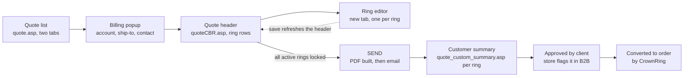
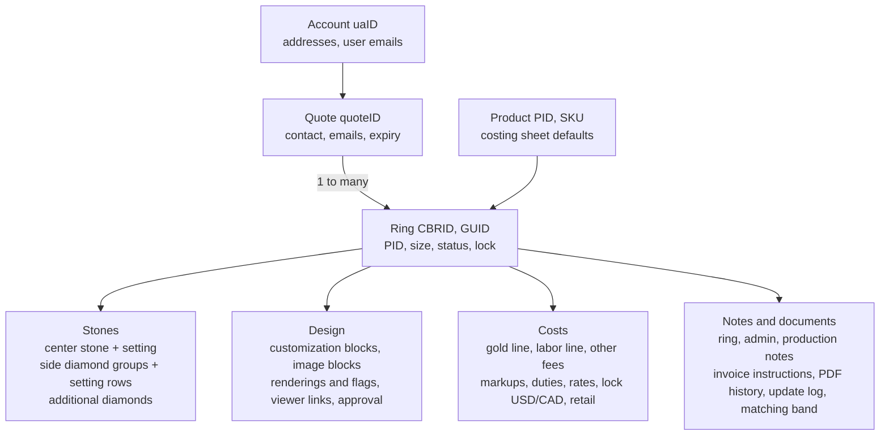

# Quote System Map for the Rebuild

As of 2026-11-04 · captured by Claude with Ludovick Bilodeau

Living copy (with the backlog tracker): https://claude.ai/artifact/PuFTq4dT8FiVJLG2V2S4Zk

## What the current system is

The quoting tool is the Quotes module of the CrownRing web admin at crownring.com/_admin, a Classic ASP application (.asp pages, POST "act=" handlers returning HTML fragments) with a jQuery front end: jQuery 1.3.2 and 3.7.1 side by side, jquery.tools overlays, a smart-search widget (smSearch.js), an image dropdown (jquery.dd), jquery-confirm, CKEditor 5 for admin comments, a drag-and-drop uploader, LogRocket and Google Analytics. CrownRing has browser access only, no source code.

This map was built from what the browser exposes: the rendered pages, their inline JavaScript (about 90 KB in the ring editor alone, read in full), the forms and endpoints they call, and the values the server returned while quotes 101575 and 101587 were entered. Server-side logic (how the SKU costing sheet is built, how PDFs and emails are generated, how the B2B side consumes a quote) is inferred from inputs and outputs only.

The map is the brief for a rebuild that keeps the behaviour the quoters rely on, fixes what is broken, and folds the Regular Quotes flow into Custom Bridal. It pairs with the Custom Bridal Quote Procedure, which describes how a quote is made.

## Screens and flow



The list page has two tabs (Quotes, Custom Bridal Quotes) with filters by quote number, ref number, company and date, and row colours for Pending, Approved by client and Converted. The Billing popup creates the quote; the header page holds the ring rows, the email block and admin comments; the ring editor opens in a new tab per ring and refreshes the header through window.opener when it saves. The customer-facing summary page (quote_custom_summary.asp, by ring GUID) is what the store sees. Expiry is 15 days from the quote date; the list offers a 15-day extension per quote.

Each ring row on the header carries: status (Active, Inactive, Pending), brand line, SKU with a "-C" suffix, ref number, Duplicate, Preview, Ring Notes, Production Notes (5 lines of 110 characters), Admin Notes, Viewer Links (two 3D viewer URLs), Completed badge, metal, colour, size, quantity, locked price and a remove icon. The Regular Quotes tab (quoteEdit.asp) was not walked through and still needs capture.

## Data model



The shape above is read off the ring editor's save routine, which posts one record at a time. The field lists below are what it sends; they are the minimum the rebuild must store.

| Record | Fields (as posted by the current editor) |
| --- | --- |
| Quote | quoteID, uaID, shippingID, ctName, ctEmails (semicolon list), comments, isCommIncludEmail, internalComments (HTML), date quoted, expiry, last sent, status (pending, approved, converted) |
| Ring | CBRID, CBRUID (GUID for the public page), quoteID, PID, ringName, ringSize (-1 pending, 0 N/A), finishingID, ringKaratID, ringColourID, ringMM, thickness, thicknessBottom, isEnabled (1, 0, -1), qty, status (completed), isApproved, priceUSD, priceCAD, finalCost, lockPriceUSD, lockPriceCAD, retailRate, exchangeRate, discount, isFinalPrice0, note, adminNote, ntrnlNote × 5, invoiceInstructions, link1, link2, isDesignNeedsApproval (+ priority, date, time, request types), isDesignApproved4Prod (+ text), isRequest_photo, isFancyPhotoValidated, isShowNclientPreview, MB_isMatchRing, MB_type, MB_val |
| Center diamond (CDI) | stoneProvider, stoneCatID, stoneTypeID, stoneKindID, diamondShapeID, diamondSizeID, qty, psID (+ ps_custom), colourID, stoneDimensionL/W/D, DW, pricePerCarat, certID, stoneCost, notes, addlNotes, isPending, markup |
| Center-stone setting (SCSI) | sendStone4Setting (1, 0, -1), contactName, settingChargeID, settingCost, notes, isPending, markup |
| Side diamond group | sdID, stoneProvider, stoneCatID, stoneTypeID, stoneKindID, psID, colourID, diamondShapeID, diamondSizeID, qty, pricePerCarat; setting rows: sdsID, qty, settingStyleID, settingLocationID, settingCost |
| Additional diamond | adID, same stone fields plus stoneDimensionL/W/D, settingStyleID, settingLocationID, certID, stoneCost, isPending, markup; one additional-diamond setting block (ADS: sendStone4Setting, contactName, qty, settingChargeID, settingCost, isPending, markup) |
| Customization block | ID, modelTypeID (Gallery 5, Head 3, Shank 4, Band 7, Pendant 10, Bracelet 11, Earrings 12, Other 13), style, PID, isPIDImgMain, isPIDImgAlt, img, modifIDs (up to 4), karatID, colourID, notes |
| Image block | imgID, sorting, PID, modelTypeID, imgName (up to 15 blocks) |
| Rendering | rID, sorting, fileName, imgName, dateUpl, isChecked (show in quote), isShowInJobbag (max 2), isTitleImg (max 2) |
| Gold line | gold_karatID, goldCostPerGram (live), finishedGramWeight, goldLoss, extraChargePerPiece, cost, markup |
| Labor line | costingLabor, rhodium, polishing, laserEngraving, extra1, extra2, handEngra, millgrain, CADFee, chainFee (not saved today), giftBox, SPIFF, eagleClaw, cost, markup |
| Other fee | ofID, cadPrintFeeID, qty, cadPrintCost, isPending, markup |
| PDF history, update log | per ring: generated PDFs with dates; field-level change log (logs_form) |

Identifiers: quote numbers are one sequence shared by Regular and Custom Bridal quotes (101460 CBR, 101461 regular, 101575 and 101587 from this walkthrough); ring refs (CBRID 57056 to 57091) are a separate sequence; the public summary page uses the ring GUID.

## Pricing engine

All pricing math runs in the browser (loadTotals_binding in the ring editor). The server supplies the inputs: the SKU's costing sheet (default weight, labor lines, side stones), the live metal rate per gram, stone prices per carat (productEdit_act.asp bridalCost_getPricePerCarat), stone weights per size (rawDiamondCosts_act.asp), setting costs per style, the exchange rate, duties and default markups. The server then stores whatever the browser computed (priceUSD, priceCAD, finalCost, lock prices, rates). A rebuild should move the formulas server-side and keep the browser as a display.

```
goldCost   = rate_per_g × weight_g × (1 + loss) + extraPerPiece
sideCost   = Σ groups ( qty × singleWeight × pricePerCt + Σ settingRows qty × settingCost )
final_i    = cost_i × (1 + duties_i) × qty_i
sell_i     = cost_i × (1 + duties_i) × markup_i × qty_i
sellUSD    = round( Σ sell_i )
sellCAD    = sellUSD × fx
retail     = (lock > 0 ? lock : sell) × (1 + tariff) × (1 − discount)
grossMargin = (sellUSD − Σ final_i) / sellUSD
```

Observed defaults: duties 6.5% on gold, labor and side diamonds, 0% on the center stone, its setting, additional diamonds and the CAD print fee; markups 1.4 center stone, 2 center setting, 1.7 elsewhere (the additional-diamond default showed 1.7 one day and 2 the next, so it is configured somewhere); loss 12% karat gold, 20% platinum; exchange rate 1.42; tariff 0%; discount 0% (applied at order time); "Retail x 2" is displayed but the retail multiplier in code is hard-coded to 1, so retail equals the locked price. Lab melee priced at $120/ct; bridal setting $1 per melee stone; center-stone setting charges: Center Stone $40, Customer Providing $10, Volume Providing $5, Glow $4, Melees $1, Stackable / Studio $0.70. The USD sell is rounded to whole dollars, CAD to whole dollars; the lock is typed by the quoter (rule: round up to $5).

Send guard: every row on the header must have data-isLockedPrice set (the locked USD amount) before SEND or COPY EMAIL will run. Lock requires a non-zero finished gram weight. isFinalPrice0 zeroes the displayed sell and tariff lines (price on request).

## Server endpoints

All under /_admin/ unless noted; all POST with an act parameter, returning HTML fragments (or a bare value). Pages: quote.asp (list), quoteEdit.asp (regular quote), quoteCBR.asp (CBR header), quote_customBridal.asp (ring editor), /quote_custom_summary.asp?CBRUID= (public summary), JobBagpdf/ (job bag PDF), /b2b/ (retailer site, impersonated via "Log As").

| Handler | act values | Purpose |
| --- | --- | --- |
| quote.asp (form f) | delete, paging (pgActu), sort (orderBy), filters (SM_val, CBRID, company, dateQuotedFrom/To, viewConverted, viewExpired, viewCBR) | List, filter, delete |
| quote_act.asp | previewQuote, addExtended, XportCBR | Regular preview, 15-day extension, CBR export of selected quotes |
| quote_act.asp | quoteCBRUpd (whole header form), CBR_isEnabled, CBR_qtyUpd, CBR_delete, CBR_noteUpd, CBR_ntrnlNoteUpd, CBR_adminNoteUpd, CBR_linksUpd, CBR_acceptDecline_upd, CBR_dismissApproval, quoteInternalComments_Upd, CBR_CBQ_addEmail | Header-level edits; quoteCBRUpd with quoteID=0 creates the quote |
| quote_act.asp | CBR_createPDF (CBRIDs, isRetail), CBR_PDFready (fileName, polled every 4 s up to 20 times), CBR_sendEmail (form + isNot4Send, isRetail) | Send flow and COPY EMAIL |
| quote_act.asp | CBR_SM_style (style search), CBR_getSKUDD (style to SKUs), CBR_getKaratColourDD (PID to karat/colour) | Style and SKU lookups |
| quote_customBridal_act.asp | bridalQuote_add (billing popup), CBR_duplicateRing_form, CBR_duplicateRing_roots (ringName, isNewQuote 0/1/2, CopyImageRenderings) | Quote creation, duplicate |
| quote_customBridal_act.asp | loadImg, loadBlockImg, loadBlockImg_styleDetails (+ _form, _upd), loadCustom, loadCustom_block, loadCustom_delete, loadCenterDiamondInfo, loadCenterDiamond_addlInfo, loadSettingCenterStoneInfo, loadRequest, loadGoldCharge, loadLaborCharge, loadSideDiamond, loadSideDiamondDetails, loadSideDiamondDetails_settings, loadAddlDiamond, loadAddlDiamondDetails, loadXtraBlock1, loadOtherFeeSection, loadTotals, loadRendringSection, loadPDFHistory, loadMatchBand | Ring editor sections, loaded one at a time by a loadingStep state machine (0.5, 1, 2, 4 to 9, 11, 11.5, 12 to 16, 50) |
| quote_customBridal_act.asp | save2quote (returns CBRID), save2quote_img_cleanup, save2quote_img, save2quote_fancyImg, save2quote_custom, save2quote_addlDiamond_cleanup, save2quote_addlDiamond, save2quote_sideDiamond_cleanup, save2quote_sideDiamond, save2quote_sideDiamondSettings_cleanup, save2quote_sideDiamondSettings, save2quote_otherFee, save2quote_rendering_cleanup, save2quote_rendering | Ring save: 15 to 30 sequential posts chained by callbacks and setTimeout |
| quote_customBridal_act.asp | DDcert_*, AC_DDSettingLocation_*, DDSettingStyle_*, ADS_DDSettingCharge_*, OF_CADPrint_* (each _form, _upd, _del, _loadDD), settingCenterStone_notes_form, imgUpl_form | Inline admin of lookup tables and small forms |
| custombridal_rs (act=addimg, multipart files[]) | | Rendering image upload |
| productEdit_act.asp | bridalCost_getPricePerCarat (stoneCat, type, kind, shape, size, psID) | Stone price per carat |
| rawDiamondCosts_act.asp | getDiamondWeight (diamondSize) | Stone weight per size |
| productEdit_bridalCosting.asp?recID=PID | | Product costing sheet (shown read-only in an overlay) |
| userAccount_act.asp | SM_company (+ SQL fragment "and clientStatus='Active Client'" sent from the client) | Account search; userAccountEdit.asp?recID= opens the account |
| /b2b/_cart.asp | confirmEmails_form (uaID) | Email picker shared with the B2B cart |
| home_act.asp | logs_form (section, PID), log2B2B (impersonation) | Change log, Log As |

## Lookup and configuration tables

These lists were read from the live dropdowns and must exist in the rebuild (ideally exported from the current database rather than retyped).

| Table | Size seen | Notes |
| --- | --- | --- |
| Products / SKUs with bridal costing sheet | thousands | Style code, SKU, PID, karat, colour, width, thickness, default weight, labor lines, side-stone groups, images (/images/xlarge/<sku>.jpg); generic CUSTOM-* styles |
| Karat / metal | 67 | 10K, 14K, 18K, 19K, 22K, 24K, platinum 950, palladium, silver, tantalum, cobalt, mixed metals with ceramic, enamel, silicone, carbon |
| Colour | 203 | White 1, NONE 20, plus two- and three-tone combinations |
| Finishing | 544 | Mostly wedding-band finishes; All High Polish (28) is the bridal default |
| Ring size | 69 | Pending, N/A, 1.5 to 16.75 by 0.25, 17, 18, 20, 22, 24 |
| Stone category / type / kind | 2 / 4 / 1 | Diamond, Gemstone; Diamond, Lab Grown, Colored, Black; None |
| Diamond shape | 49 (center), 22 (side) | Oval 16, Round 1, image dropdown |
| Diamond size | 74 | 0.8 to 8 mm plus certified carat sizes and One Of Kind; maps to a single-stone weight |
| Quality (psID) | 7 | I1, SI3-I1, SI2, SI1, CZ, VS1, Lab VS1 (10); psID 8 = custom |
| Stone colour | 61 | D to K grades, DEF etc., gemstone colours |
| Setting style | 9 | Default $1, French pave $1.50, Glow $4, Hand pave add on $5, My Caroline $3, Pave $1, Stackable / Studio $0.70, Other |
| Stone placement | 12 | Band, Basket, Bridge, Default, Gallery, Halo, Head, Peekaboo, Shank, Side stone |
| Center-stone setting charge | 9 | Center Stone $40, CrownRing Providing $0, Customer Providing $10, Glow $4, Melees $1, Stackable / Studio $0.70, Volume Providing $5, Other |
| CAD print fee tiers | 19 | 01 Brainpower to 10 Extra Deluxe, 11 Rina Extra Fee, 20+ Refs, Client is an Engineer or Surgeon, plus joke entries to remove |
| Customization section | 8 | Gallery, Head, Shank, Band, Pendant, Bracelet, Earrings, Other; modifications list (41) with images |
| Approval request type | 8 | CLIQ, Matching Sample, Need Factory Quote, Renderings, Stone Count / Weight, Vadim Prepping, Viewer Project, Wax |
| Certs | admin list | DDcert |
| Rates | per day | Metal price per gram by karat, exchange rate (1.42), duties by line, default markups, retail rate |
| Accounts | | uaID, clientStatus, addresses (shippingID), user emails; staff accounts Friends and Family Montreal (2954) and USA (4546); Crown Samples (2875) for tests |

## Known bugs, quirks and data-quality issues

1. Chain fee is never saved. save2quote reads [name=FCYFee] (no such field) and skips [name=chainFee]; a chain amount is lost on save and the labor total recomputes without it. Verified on ring 57091. Workaround: Extra 1. Worth auditing past quotes for lost chain amounts.
2. Prices are computed in the browser and stored as sent; the server never recomputes. Any client-side glitch becomes the stored price.
3. Retail multiplier: the UI says "Retail x 2" but the code multiplies by 1, so retail equals the locked (or sell) price. Either the label or the code is wrong.
4. Only the USD lock protects the price. CAD lock is a separate field and is usually left at 0; for Canadian accounts the header shows a CAD figure that floats with the exchange rate.
5. Ring save is 15 to 30 sequential posts ordered by callbacks and setTimeout; a dropped request leaves a partial ring with no error. The quote itself is created by the first ring save (quoteID stays 0 until then).
6. Size and Finishing populate asynchronously after the editor reloads; they look blank or Pending for a second.
7. Side-diamond quantity must be set on the stone row and again on its setting row; the placement dropdown is rebuilt after a quantity change and loses an earlier choice.
8. Completed = YES validation can be skipped for everything except size, producing "completed" rings with pending data (the red "!" on the list is the only signal).
9. Account email picker shows duplicate and case-variant addresses (ilan@ four times, jennifer.lavigne@ five times on the Friends and Family account); shipping addresses show as blank labels.
10. The account search passes a SQL fragment from the browser ("and clientStatus='Active Client'"); the handler is injection-prone.
11. Two jQuery versions (1.3.2 and 3.7.1) and jQuery Tools overlays coexist; the page carries 300 KB of inline CKEditor CSS.
12. Duplicate IDs in the DOM (several divSideDiamondDetails, divCenterDiamondInfo), which breaks any id-based selection beyond the first element.
13. Custom fashion template has no colour, width or thickness and a placeholder weight of 5.75 g; nothing prompts the quoter to fix them.
14. The CAD print fee list contains joke entries ("Dodgie is annoying fee", "When Vicky is tired") that can appear on a quote.
15. Diamond size list has no 3.35 mm; the factory's sieve sizes do not map one to one.

## Improvement backlog

| # | Improvement | Source | Priority | Status |
| --- | --- | --- | --- | --- |
| 1 | Fold the Regular Quotes flow (machine-made bands) into Custom Bridal so there is one quote type | Ludovick | High | Agreed |
| 2 | Pull contact name and email from the centralised contact list instead of typing them per quote | Ludovick | High | Agreed |
| 3 | Fix the Chain fee save bug (and audit old quotes) | Observed | High | Proposed |
| 4 | Compute prices server-side from stored inputs; store inputs, not only results; keep a price snapshot per lock | Observed | High | Proposed |
| 5 | Duplicate ring with a metal switch: re-pull SKU, rate, weight and loss for the new metal instead of re-keying | Observed | Medium | Proposed |
| 6 | One transactional save per ring with an error shown on failure | Observed | Medium | Proposed |
| 7 | Lock both currencies in one step from one rule (round up to $5, CAD from the rate) | Observed | Medium | Proposed |
| 8 | Show shipping addresses as text; de-duplicate and normalise account emails | Observed | Medium | Proposed |
| 9 | Stone group quantity drives its setting rows automatically; placement chosen in any order | Observed | Medium | Proposed |
| 10 | Make pending items first-class fields on the ring and on the list (replace the red "!" tooltip) | Observed | Low | Proposed |
| 11 | A Necklace / chain section with length and finding fields; a custom-fashion checklist (colour, weight, chain) | Observed | Low | Proposed |
| 12 | Clean the CAD print fee tiers; map factory sieve sizes to mm sizes | Observed | Low | Proposed |
| 13 | Factory-price rule as a field: enter the factory price and let the system show the shortfall to cover | Observed | Medium | Proposed |

## Rebuild recommendations

Build a behaviour-compatible replacement, not a port. The quoters' mental model (quote, rings, sections, totals table, lock, completed, send) is sound and should be kept as is; what should change is underneath it.

**Keep.** The quote / ring / child-record model; the section order of the ring editor; the totals table with per-line cost, duties, markup and sell; USD and CAD; the lock-and-expiry mechanism; the Completed check with its pending items; per-ring notes (customer, production, admin, invoice); renderings with the three flags; the public summary page per ring; the send flow with PDF and email; the Duplicate, Replacement and Repair options; the change log.

**Change.** Pricing as a server-side function of stored inputs (SKU costing, rates on the day, stone tables, markups, duties), with a saved snapshot whenever a price is locked or sent. One request to save a ring. Contacts from the central list. A single quote type with a "product kind" (cast bridal, machine-made band, custom fashion) that switches which sections and defaults apply, which is how Regular Quotes fold in. Pending items as fields and filters. Lookup tables exported from the current database (products with costing sheets, karats, colours, finishings, sizes, shapes, stone sizes and weights, qualities, setting styles and charges, placements, CAD tiers, customization sections and modifications, approval types, certs), then cleaned.

**Suggested stack.** Any modern web stack works; the constraints are the integrations: the live metal rate, the product and costing database, the B2B retailer site (approval, Log As), the order system the quote converts into, the PDF and email generation, and the 3D viewer links. Those boundaries are the first things to confirm with whoever can see the server side.

**Still to capture before building.**

- [x] Regular Quotes flow (quoteEdit.asp) for machine-made bands: fields, pricing, send — captured read-only on 2026-11-05, see capture-2026-11-05.md (the cost form behind "Cost" is still unseen)
- [ ] A quote with a CrownRing-supplied center stone (stone provider Crownring: the extra fields, cert, price per carat)
- [ ] A quote with Additional Diamonds and the setting block
- [ ] The CAD team's side: design approval, renderings, weight update and lock
- [ ] SEND end to end on a test account, the PDF, the email and the public summary page as the store sees it
- [ ] Store approval in the B2B site and conversion to an order
- [ ] Unlock and relock after expiry; the 15-day extension
- [ ] Karat code N in the SKU list; CAD lock rule for Canadian accounts
- [ ] Where the live metal rate, exchange rate, duties and markups are configured
- [x] Export of the lookup tables (all ring-editor dropdowns dumped from the DOM on 2026-11-05 → assets/js/data/live-lookups.json) · [ ] the product costing sheets and the stone weight per size

Working material from the walkthrough (page captures, the ring editor's JavaScript, the sample request and spec sheet) is in this repo under docs/ and reference/.
